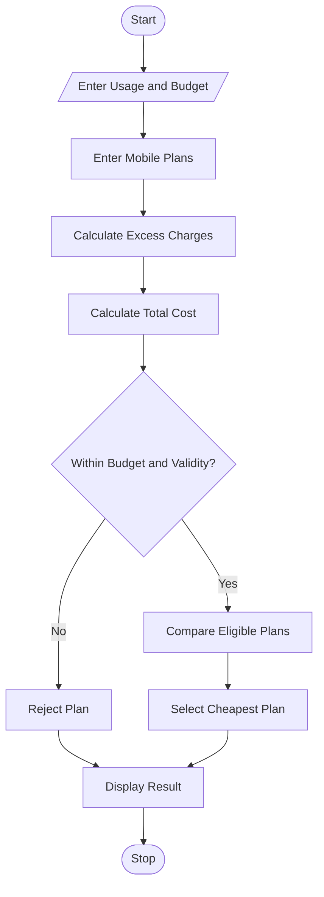

# Multi-Plan Telecommunications Cost Optimization Using Python

## 1. Problem Statement

The Telecommunications Cost Optimization System compares different mobile plans based on data usage, call minutes, validity, and budget. It calculates excess charges and identifies the most economical eligible mobile plan.

## 2. Algorithm

1. Start the program.
2. Enter user usage details and budget.
3. Enter mobile plan details.
4. Calculate excess usage charges.
5. Calculate total plan cost.
6. Check validity and budget.
7. Select the cheapest eligible plan.
8. Display the result.
9. Stop.

## 3. Flowchart

## 5. Sample Input
Enter data usage (GB): 3
Enter call minutes: 150
Enter budget: 500
Enter required validity days: 28

## 6. Sample Output
Plan A Total Cost: 239
Plan B Total Cost: 299
Plan C Total Cost: 399

--- BEST MOBILE PLAN ---
Plan: Plan B
Total Cost: Rs. 299

