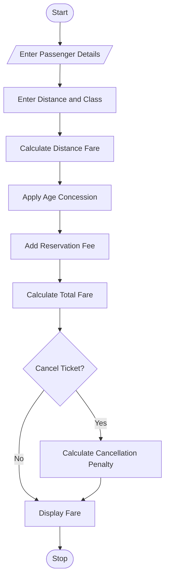

# 6. Railway Fare and Reservation Calculator Using Python

## 1. Problem Statement

The Railway Fare and Reservation Calculator calculates ticket fares for multiple passengers based on distance, travel class, age-based concessions, reservation fees, and cancellation penalties. It displays the total ticket cost and cancellation amount.

## 2. Algorithm

1. Start the program.
2. Enter passenger details.
3. Enter travel distance and class.
4. Calculate fare using distance slabs.
5. Apply age-based concession.
6. Add reservation fees.
7. Calculate total fare.
8. Apply cancellation penalty if required.
9. Display the final fare.
10. Stop.

## 3. Flowchart

## 5. Sample Input
Enter number of passengers: 2
Enter travel distance (km): 200

Passenger 1
Enter name: Ravi
Enter age: 30
Enter class (Sleeper/AC): sleeper

Passenger 2
Enter name: Sita
Enter age: 65
Enter class (Sleeper/AC): ac

Cancel tickets? (yes/no): yes

## 6. Sample Output
Passenger: Ravi
Ticket Fare: Rs. 370.0

Passenger: Sita
Ticket Fare: Rs. 475.0

Total Reservation Fare: Rs. 845.0

Cancellation Penalty: Rs. 169.0
Refund Amount: Rs. 676.0

